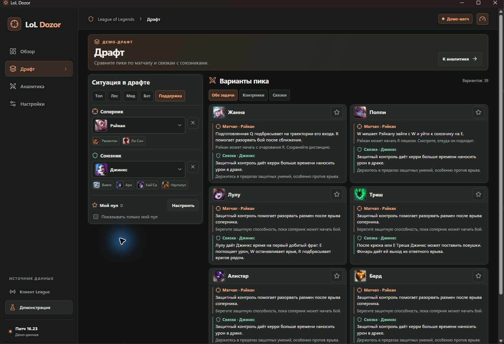

# LoL Dozor

Настольный помощник для League of Legends на Tauri 2, Rust, React и TypeScript. Показывает состояние клиента, составы команд и анализ линии в отдельном окне для второго монитора.

[Скачать LoL Dozor для Windows x64](https://github.com/Linsaym/lol-dozor/releases/latest)



## Быстрый старт

Понадобятся Node.js 24 с npm, Rust через `rustup`, Microsoft C++ Build Tools с компонентами C++ и Windows SDK, а также WebView2 Runtime. Версии инструментов указаны в [`.node-version`](.node-version) и [`rust-toolchain.toml`](rust-toolchain.toml). [Требования Tauri для Windows](https://v2.tauri.app/start/prerequisites/#windows).

Из корня проекта в PowerShell:

```powershell
npm ci
npm run dev:desktop
```

При первом запуске Cargo скачает и соберёт зависимости. Должно открыться окно **LoL Dozor**. Для работы только с интерфейсом запустите `npm run dev` и откройте <http://127.0.0.1:1420>. Используйте один режим за раз, поскольку оба используют порт 1420.

## Использование

- **Клиент League.** Запустите League of Legends и войдите. Dozor покажет фазу клиента. После начала игры аналитика открывается автоматически по данным локального клиента. Режим поддерживает составы двух команд.
- **Демонстрация.** Откройте пример матча в боковой панели. Демонстрационные игроки и статистика фиктивны. Портреты, предметы и способности из Data Dragon входят в сборку и доступны без интернета.
- **Riot API.** Получите временный Developer API Key в [Riot Developer Portal](https://developer.riotgames.com/). В настройках Dozor вставьте его и нажмите **Сохранить и проверить**. После истечения срока вставьте новый ключ в то же поле. Данные аккаунтов, ранги и историю запрашивает Rust.
- **Драфт.** При выборе чемпионов Dozor автоматически открывает драфт и подставляет назначенную позицию. Нажмите на открытый пик или найдите чемпиона вручную. Укажите соперника, союзника или обоих, чтобы сравнить контрпики и связки. Варианты объясняют взаимодействия умений и учитывают баны, подтверждённые пики и доступность по данным клиента. Отметьте знакомых чемпионов звёздочкой, чтобы фильтровать по своему пулу. Вкладка доступна как планировщик и в демонстрации.
- **Матчап.** Dozor предлагает соперника по позиции, если клиент передал позиции. Поле **Соперник** позволяет выбрать его вручную. В живом матче винрейт считается по недавним играм пользователя на его чемпионе против этого соперника на той же позиции. Билд подбирается по предметам из побед в доступной истории. Для небольшой выборки отображается число игр.
- **Второй монитор.** Кнопка с индикатором плотности включает компактный режим. После закрытия приложение запоминает размеры, позицию на мониторе и состояние развёрнутого окна.

## Проверки и сборка

| Команда                 | Что делает                                                                 |
| ----------------------- | -------------------------------------------------------------------------- |
| `npm run check:web`     | Prettier, ESLint, Vitest, проверка типов и сборка Vite                     |
| `npm run check:rust`    | rustfmt, Clippy с ошибкой на предупреждениях и Cargo test                  |
| `npm run check`         | Все перечисленные проверки                                                 |
| `npm run build:smoke`   | Сборка Windows-исполняемого файла с встроенным фронтендом, без установщика |
| `npm run build:desktop` | Релизная сборка Tauri с установщиками                                      |

GitHub Actions запускает `npm ci`, `npm run check` и `npm run build:smoke` на Windows при push и pull request. Конфигурация находится в [`.github/workflows/ci.yml`](.github/workflows/ci.yml).

Для начала работы над задачей прочитайте [`AGENTS.md`](AGENTS.md) и [описание архитектуры](docs/architecture.md).

LoL Dozor — независимый проект. Riot Games не спонсирует и не поддерживает его. League of Legends и игровые материалы принадлежат Riot Games.
